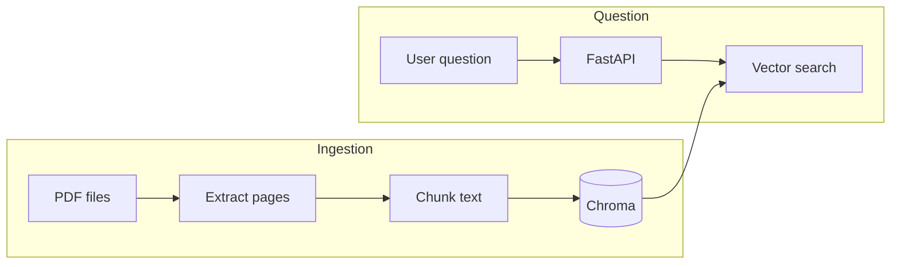

# PDF RAG Assistant

Ask questions about your own PDFs and get answers that cite the source document and page.

This project is a retrieval-augmented generation (RAG) pipeline built in Python. It extracts text from PDFs, splits it into chunks tagged with file name and page number, stores embeddings in a vector database, and serves search results through a FastAPI backend. It is being built in three stages: a local version first, then a migration to AWS, then CI/CD and evaluation.

I'm testing it on my own FPGA and RISC-V lab reports.

## Status

- [x] PDF text extraction with page-level metadata
- [x] Chunking with configurable size and overlap
- [x] Local embeddings and vector search with Chroma
- [x] FastAPI `/search` endpoint with request validation
- [ ] `/ask` endpoint: LLM answer generation with citations
- [ ] pytest tests for chunking and retrieval
- [ ] AWS deployment: S3, Lambda, Bedrock, RDS pgvector, App Runner
- [ ] GitHub Actions CI/CD
- [ ] Retrieval evaluation across chunk sizes

## How it works



**Ingestion** runs once per PDF. Each page's text is extracted with `pypdf`, whitespace is normalized, and the text is split into overlapping chunks. Each chunk keeps its source file, page number, and chunk index so answers can be cited. Chunks are embedded and stored in Chroma using `upsert`, so re-running ingestion does not create duplicates.

**Search** embeds the user's question with the same model and returns the `k` closest chunks, along with their source, page, and distance score (lower distance means more similar).

## Project structure

```
rag-assistant/
├── app/
│   ├── ingest.py      # extract_pages, chunk_pages
│   ├── store.py       # build_index, search (Chroma)
│   └── api.py         # FastAPI app
├── experiments/
│   └── embedding_similarity.py
├── data/              # your PDFs (git-ignored)
└── requirements.txt
```

## Getting started

Requires Python 3.10 or newer.

```bash
git clone git@github.com:SijingDeng24/rag-assistant.git
cd rag-assistant
python3 -m venv .venv
source .venv/bin/activate
pip install -r requirements.txt
mkdir data
```

Copy a PDF into `data/`, then update the file path in the `__main__` block of `app/store.py`.

**Build the index:**

```bash
python -m app.store
```

**Start the API:**

```bash
uvicorn app.api:app --reload
```

Open http://127.0.0.1:8000/docs for an interactive test page, or call it directly:

```bash
curl -X POST http://127.0.0.1:8000/search \
  -H "Content-Type: application/json" \
  -d '{"question": "How is signed overflow detected?", "k": 3}'
```

The first run downloads a small embedding model (about 80 MB).

## Design decisions

**Chunk size: 800 characters, 150 overlap.** I tested slices of 160 and 800 characters on a real page. At 160, an explanation was cut off before the key sentence. One complete idea in my reports spans a few hundred characters, so 800 is the starting point. Overlap means a sentence cut at a boundary still appears whole in a neighboring chunk. This will be tuned with measured retrieval accuracy.

**Retrieve top 3, not top 1.** Embedding search matches topic better than intent. For "How is signed overflow detected?", the top result was a table of overflow test cases, while the actual rule appeared in the second and third results. Retrieving three chunks gives the LLM both.

**Near-empty pages are skipped.** Pages with fewer than 100 characters of text after cleanup produce no chunks.

**Idempotent ingestion.** Each chunk gets a unique ID built from source, page, and chunk index, and is written with `upsert`. This matters for the AWS version, where Lambda may retry an ingestion automatically.

## Known limitations

- **Tables and figures stored as images are not extracted.** `pypdf` reads only text, so screenshot tables are invisible to search. Planned fix: a vision-capable model through Amazon Bedrock.
- **Font ligatures can garble text.** For example, "tt" may extract as `+` and "ti" as `9`. Unicode normalization fixes some but not all cases.
- **Fixed-size chunks ignore sentence boundaries,** so a chunk can begin mid-word.
- **The local embedding model is small.** Similarity scores are useful for ranking but compressed; a managed embedding model may separate meanings better.

## Roadmap

**AWS deployment.** S3 for document storage, Lambda triggered on upload for ingestion, Amazon Bedrock for embeddings and the LLM, Postgres with pgvector on RDS for vectors, and the API in a Docker container on App Runner. IAM roles with least-privilege permissions, with secrets in Secrets Manager.

**Evaluation and CI/CD.** A set of about 20 test questions to measure how often the correct chunk appears in the top results, compared across chunk sizes. GitHub Actions to run tests and deploy on every push.
